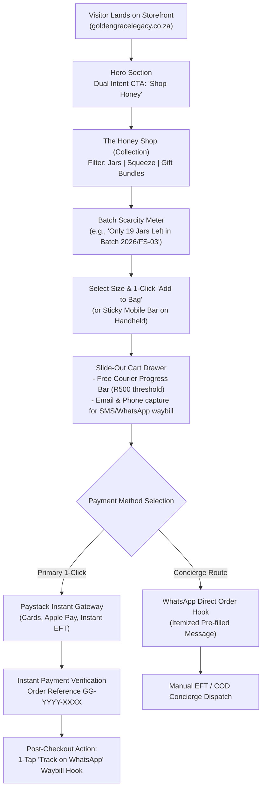
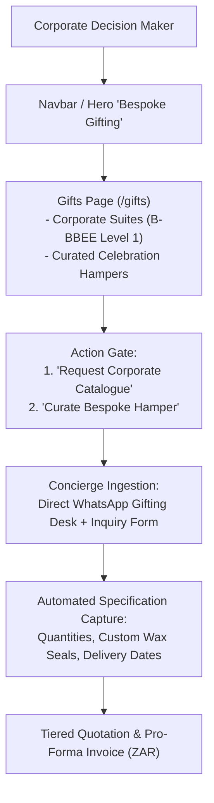
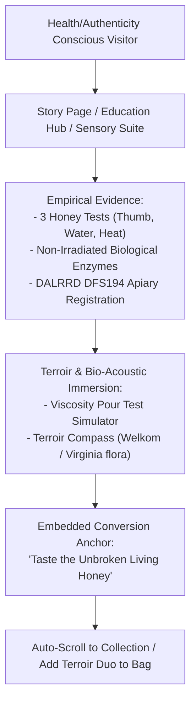
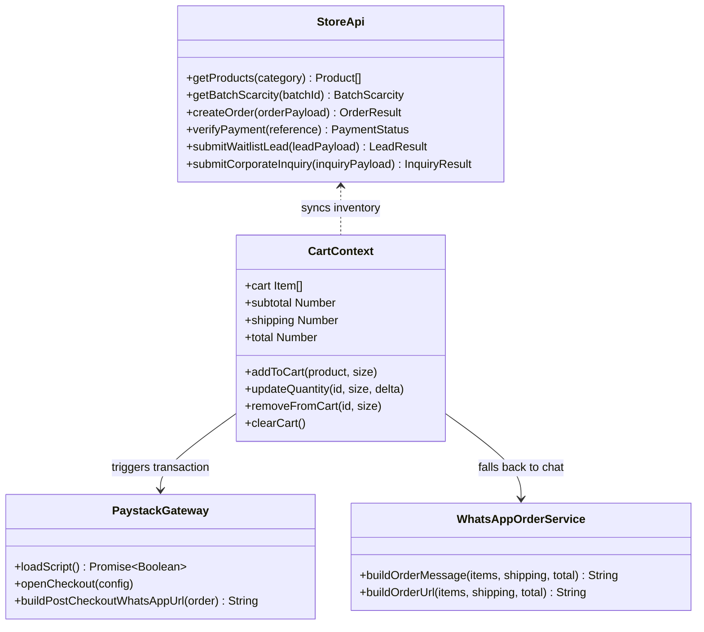

# Golden Grace Legacy: E-Commerce Architecture & Conversion User Flow
**Official Online Storefront:** [goldengracelegacy.co.za](https://goldengracelegacy.co.za) / [goldengracelegacy.vercel.app](https://goldengracelegacy.vercel.app)  
**Primary Mandate:** Commercial conversion engine for 100% pure raw South African honey and bespoke honey-centric / corporate gifting suites. All educational, heritage, and scientific narratives act as sovereign authority anchors to fuel sales conversion.

---

## 1. Executive Summary & Brand Hierarchy

```
+---------------------------------------------------------------------------------+
|                         GOLDEN GRACE LEGACY (Holding)                           |
|                      "Bespoke Living Gold & Heritage"                           |
+---------------------------------------------------------------------------------+
                                      |
         +----------------------------+----------------------------+
         |                                                         |
         v                                                         v
+------------------------------------+   +---------------------------------------+
|        GOLDEN GRACE HONEY          |   |      BESPOKE & CORPORATE SUITES       |
|    (Pure Raw Honey Retail Line)    |   |  (Executive Hampers, Custom Seals)    |
| - Welkom Central Aloe Ferox        |   | - B-BBEE Level 1 Compliant Suites     |
| - Northern Belt Veld Wildflower    |   | - Wedding & Celebration Favors        |
| - Highland Plains Cosmos (Reserve) |   | - Institutional VIP Gift Sets         |
| - Terroir Discovery Duo (Bundle)   |   | - Custom Wood & Wax-Sealed Boxes      |
+------------------------------------+   +---------------------------------------+
```

### Core Business Model
1. **Direct-to-Consumer (D2C) Retail:** Impulse and subscription-like repeat purchases of raw table honey (hexagonal jars, daily squeezes, starter bundles). Checkout is optimized for **1-click Paystack checkout** (Apple Pay, Debit/Credit Card, Instant EFT) and instant **WhatsApp dispatch waybill routing**.
2. **Corporate & Bespoke Gifting (B2B / VIP):** High-ticket volume sales for corporate year-end, executive client appreciation, and luxury weddings. Managed through dedicated quote workflows and direct concierge links.

---

## 2. High-Conversion User Flows

### Flow A: Direct Retail Honey Purchase (Speed to Transaction: < 60s)



### Flow B: Corporate & Bespoke Gifting Funnel (High Average Order Value)



### Flow C: Educational & Terroir Authority Funnel (Trust -> Cart)



---

## 3. Frontend Component Hierarchy & Modular Tree

```
src/
├── App.jsx                       # Sovereign Root Orchestrator (Router, Cart Drawer, Global State)
├── main.jsx                      # Vite Application Entry Point
├── views.js                      # Centralized View Enumeration (HOME, STORY, EDUCATION, GIFTS, RECIPES, REVIEWS)
│
├── context/
│   └── cart-context.jsx          # Reactive Basket State, LocalStorage Sync, Threshold Calculations
│
├── hooks/
│   ├── useNavigation.js          # Hash-based Router with Backward History Stack & Transition Timing
│   ├── useAnalytics.js           # Lightweight Telemetry (Page Views, Conversion Events)
│   ├── useSEO.js                 # Dynamic Title, Description, and OpenGraph Injection
│   └── useScrollLock.js          # Body Scroll Locking for Modal / Drawer Accessibility
│
├── services/
│   ├── contracts.js              # TypeScript-grade Type Contracts & Payload Validators
│   └── store-api.js              # Unified Store API Client (Products, Scarcity, Orders, Leads)
│
├── data/
│   ├── catalog.js                # Pure ESM Data: Products, Batches, Scarcity, Video Chapters
│   └── constants.jsx             # Presentation Constants, Certifications (DFS194, HACCP), Honey Tests
│
├── utils/
│   ├── paystack.js               # Paystack Inline Gateway, Test Fallback, Script Injector
│   ├── whatsapp-order.js         # Itemized WhatsApp URL Generator & Encoding
│   └── media-gating.js           # Bandwidth & Hardware Adaptive Video/Animation Throttler
│
├── components/
│   ├── layout/
│   │   ├── navbar.jsx            # Dual Brand Lockup ('GOLDEN GRACE' + 'LEGACY'), Cart Counter, Mobile Menu
│   │   ├── footer.jsx            # Sovereign Footer, Kingdom Nexus Terroir Telemetry, Certifications
│   │   ├── container.jsx         # Responsive Max-Width Wrapper
│   │   └── section.jsx           # Semantic Section with Spacing Tokens
│   │
│   ├── ui/
│   │   ├── product-card.jsx      # Reusable Product Card with Gallery, Scarcity Bar & Quick Add
│   │   ├── sticky-mobile-cart-bar.jsx # Persistent Mobile Thumb-Zone Add-to-Bag Bar
│   │   ├── waitlist-modal.jsx    # Pre-order Lead Capture for Limited Seasonal Blooms
│   │   ├── section-heading.jsx   # Consistent Typographic Hierarchy with Honeycomb Accents
│   │   ├── glass-card.jsx        # Glassmorphic Backdrop Filter Container
│   │   ├── terroir-compass.jsx   # Interactive Free State Terroir Telemetry
│   │   ├── viscosity-pour.jsx    # Physics-Based Interactive Honey Resistance Simulator
│   │   ├── bio-acoustic-hum.jsx  # Hive Frequency Audio Synthesizer (528Hz Solfeggio)
│   │   ├── detail-modal.jsx      # Deep Educational Exploded-View Modal
│   │   └── optimized-image.jsx   # Responsive Image with Aspect-Ratio & Lazy Loading
│   │
│   └── common/
│       ├── top-progress-bar.jsx  # Route Transition Progress Indicator
│       ├── pwa-install-banner.jsx# Add to Home Screen Native Web App Prompt
│       ├── whatsapp-widget.jsx   # Floating Concierge Drawer with 4 Quick Actions
│       ├── forager-loader.jsx    # Initial Hive Relocation Atmospheric Preloader
│       ├── error-boundary.jsx    # Defensive Graceful Degradation Wrapper
│       ├── scroll-to-top.jsx     # Viewport Reset on Route Navigation
│       ├── breadcrumbs.jsx       # Structured Hierarchy Navigation Trail
│       ├── modal.jsx             # Accessible Dialog Primitive with ESC & Focus Trapping
│       ├── image-modal.jsx       # Lightbox Image Zoom Viewer
│       ├── video-modal.jsx       # Native HTML5 Video Modal with Chapter Navigation
│       └── toast.jsx             # Ephemeral Conversion & Cart Notifications
│
└── pages/
    ├── home-page/
    │   ├── home-page.jsx         # Primary Conversion Funnel Layout
    │   └── sections/
    │       ├── hero.jsx          # Cinematic Sovereign Entry, Terroir Badges, Shop CTA
    │       ├── trust-bar.jsx     # DALRRD DFS194, CoA, B-BBEE L1 Marquee
    │       ├── collection.jsx    # The Honey Shop: Category Tabs, Scarcity, Instant Add
    │       ├── story.jsx         # Founder Testimony & Women-Led Collective Teaser
    │       ├── journey.jsx       # The 3-Step Extraction Technical Timeline
    │       ├── testimony-ribbon.jsx # High-Velocity Social Proof Ribbon
    │       ├── sensory.jsx       # Terroir Compass & Viscosity Pour Test
    │       ├── authenticity.jsx  # 3 Empirical Honey Tests (Thumb, Water, Heat)
    │       ├── archive.jsx       # Visual Gallery of Free State Apiary Frames
    │       ├── content-break.jsx # Visual Palette Cleanser & Gifting Pivot
    │       └── cart.jsx          # Slide-Out Checkout Drawer with Paystack & WhatsApp
    │
    ├── gifts-page.jsx            # Bespoke Corporate Suites & Custom Hampers
    ├── story-page.jsx            # Deep Heritage & Free State Apiaries Lore
    ├── education-page.jsx        # Complete Honey Codex, Botany & Bio-Science
    ├── recipes-page.jsx          # Gastronomic Pairings & Raw Honey Culinary Uses
    ├── reviews-page.jsx          # Verified Consumer Testimonials & Batch Reviews
    └── maintenance-page.jsx      # Sovereign VIP Maintenance Gate with WhatsApp Direct
```

---

## 4. Shared Services Architecture



### Shared Service Principles
1. **Zero-Dependency Resilience:** Core contracts (`catalog.js`, `store-api.js`, `whatsapp-order.js`) are pure JavaScript / ESM with 0 framework coupling, executable across Node.js, Vite, and Cloudflare / Vercel Edge Workers.
2. **Offline-First Graceful Degradation:** When offline or when the database API is unreachable, `StoreApi` automatically serves static catalog data and fallbacks to the WhatsApp Concierge order pipeline.
3. **Cart Immutability:** All cart updates dispatch immutable state updates and mirror immediately to `localStorage` under `gg_cart_items_v2`.
