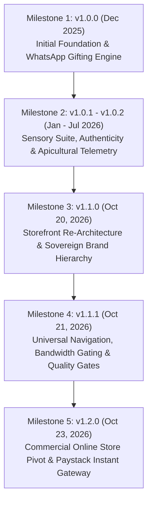

# Golden Grace Legacy: Production Release Log & Deployment Runbook

**Document Owner**: Release & Changelog Specialist, Lead Systems & Growth Engineering  
**Repository**: `golden-grace-legacy` (`goldengracelegacy/golden-grace-honey`)  
**Canonical Production URL**: [https://goldengracelegacy.co.za](https://goldengracelegacy.co.za)  
**Production Vercel Canonical**: [https://goldengracelegacy.vercel.app](https://goldengracelegacy.vercel.app)  
**Staging & Preview Deployment**: [https://golden-grace-legacy.vercel.app](https://golden-grace-legacy.vercel.app)  
**Current Active Version**: `v1.2.0`  
**Latest Production Commit**: `b9ecebf`  
**Last Verified Date**: 23 October 2026 (Audited 27 October 2026)

---

## 1. Executive Timeline & Milestone Ledger

The Golden Grace Legacy platform evolved through five major architectural milestones from initial scaffolding in December 2025 to a full-scale commercial luxury e-commerce engine in October 2026.



### Milestone Breakdown

| Milestone & Version | Release Date | Git Head | Strategic Focus & Key Deliverables |
| :--- | :---: | :---: | :--- |
| **v1.0.0** | 2025-12-25 | `f34c469` | **Foundation & Bespoke Gifting Engine**: Vite 7 / React 19 / Tailwind 3 scaffold, atmospheric hero video modal, Sankofa narrative gifting suite, basic WhatsApp order dispatch link generator. |
| **v1.0.1 - v1.0.2** | 2026-01-14 – 2026-07-15 | `970602b` | **Interactive Authenticity & Sensory Suite**: Viscosity physics simulator (`ViscosityPour`), bio-acoustic hive hum (`TerroirCompass`), DALRRD DFS194 regulatory certification display, animated marquee trust bar, 3 empirical purity tests (Thumb, Water, Heat), Forager narrative loader. |
| **v1.1.0** | 2026-10-20 | `ce3ca1a` | **Storefront Re-Architecture & Sovereign Hierarchy**: Elevation of *Golden Grace Legacy* as primary parent brand with *Honey* as luxury product line; 1Grid custom domain integration (`goldengracelegacy.co.za`); official email routing (`info@` and `grace@goldengracelegacy.co.za`); Kingdom Nexus terroir telemetry. |
| **v1.1.1** | 2026-10-21 | `ec942cd` | **Universal Navigation, Bandwidth Gating & Quality Gates**: Ambient `TopProgressBar` (250ms transition), sticky backward navigation headers, browser history synchronization (`pushState`/`popstate`), bandwidth adaptive gating (`shouldDisableAutoplay`), high-contrast honeycomb favicon suite, pure catalog decoupling, 100% line coverage test suite. |
| **v1.2.0** | 2026-10-23 | `b9ecebf` | **Commercial Online Store Pivot**: Instant 1-Click Paystack Gateway (Card, Capitec Pay, Apple Pay), sticky mobile Add-to-Bag bar, live batch scarcity countdown meters, post-checkout automated WhatsApp waybill hook, Free State Terroir Sampling Duo, PWA offline service worker, Google Rich Snippets structured data, seasonal waitlist modal, restoration of 17 modular Sankofa components, 25 high-resolution harvest media assets. |

---

## 2. Production Deployment Checklist

This checklist must be strictly satisfied before any production push to `goldengracelegacy.co.za` or `goldengracelegacy.vercel.app`.

### Phase A: Automated Pre-Deployment Quality Gates

Execute the full verification pipeline from the repository root:

```bash
npm run validate
```

The automated validation suite executes the following five gates in sequence:

- [x] **Linting Gate**: `npm run lint` (ESLint 9 passing with 0 warnings, zero syntax violations).
- [x] **Test & Coverage Gate**: `npm test` (Node native test runner executes all unit, smoke, and E2E journeys: 56 passing tests, 0 failures, 100% line coverage, **93.05% branch coverage**).
- [x] **Static Asset Integrity Gate**: `npm run check:assets` (Static asset baseline verification ensures all referenced images, icons, and videos exist in `public/`).
- [x] **Security & Secret Leak Scan**: `npm run check:security` (Scans `src/` for private keys, exposed bearer tokens, unhandled secrets, and executes `npm audit --omit=dev`).
- [x] **Production Bundle Build Gate**: `npm run build` (Vite production compiler generates optimized client chunks with code-splitting and asset compression).

### Phase B: Git Branch Parity & Release Tagging

- [x] **Branch Parity**: Verify that `development`, `preview`, and `main` branches are synchronized.
- [x] **Working Tree Cleanliness**: `git status` reports working tree clean.
- [x] **Semantic Release Tag**:
  ```bash
  git tag -a v1.2.0 -m "Release v1.2.0: Commercial Online Store Pivot"
  git push origin v1.2.0
  ```

### Phase C: Domain & DNS Routing Configuration (1Grid & Vercel)

| Record Type | Host / Name | Target / Value | TTL | Purpose |
| :--- | :--- | :--- | :---: | :--- |
| **A Record** | `@` (apex) | `76.76.21.21` | 3600 | Directs apex `goldengracelegacy.co.za` to Vercel Global Edge Network. |
| **CNAME** | `www` | `cname.vercel-dns.com` | 3600 | Directs `www.goldengracelegacy.co.za` with 301 canonical redirect to apex. |
| **MX Record** | `@` | `mail.goldengracelegacy.co.za` (Priority 10) | 3600 | Routes official inbound emails to 1Grid mail server. |
| **TXT Record** | `@` | `v=spf1 include:mail.1grid.com ~all` | 3600 | SPF record authorizing 1Grid mail servers for `info@` and `grace@`. |
| **TXT (Vercel)**| `_vercel` | `vc-domain-verify=goldengracelegacy.co.za,...` | 3600 | Automated Vercel domain verification token. |

- [x] **SSL/TLS Certificates**: Automatic Let's Encrypt Wildcard Certificate provisioned and active on Vercel Edge.
- [x] **HTTPS Enforcement**: 301 Permanent Redirect enforced from HTTP to HTTPS across all domains.
- [x] **Domain Canonicalization**: All traffic to `www.goldengracelegacy.co.za` automatically redirects to canonical `https://goldengracelegacy.co.za`.

---

## 3. Environment Variables Specification

The platform utilizes a clean separation between public client-side runtime parameters and private server-side secrets.

### Environment Variable Matrix

| Variable Name | Scope | Required Environments | Description | Example Format | Security Notes |
| :--- | :---: | :---: | :--- | :--- | :--- |
| `VITE_PAYSTACK_PUBLIC_KEY` | **Client** | Dev, Preview, Prod | Public API key used by Paystack inline popup modal (`PaystackPop`). | `pk_live_8f3a9b2c...` (Prod)<br/>`pk_test_7a1b8c...` (Dev) | **Safe for frontend bundle.** Never commit secret key (`sk_live_...`) to client repository. |
| `VITE_SUPABASE_URL` | **Client** | Dev, Preview, Prod | REST & WebSocket API endpoint for Supabase PostgreSQL database. | `https://xyzprojectref.supabase.co` | **Safe for frontend bundle.** Governed by Row Level Security (RLS). |
| `VITE_SUPABASE_ANON_KEY` | **Client** | Dev, Preview, Prod | Public anonymous JWT enabling authenticated browser queries subject to RLS. | `eyJhbGciOi...` | **Safe for frontend bundle.** Restricted by RLS policies in [`docs/SCHEMA_AND_RLS.sql`](file:///c:/Users/thoso/Sankofa_mvp/goldengracelegacy/golden-grace-honey/docs/SCHEMA_AND_RLS.sql). |
| `PAYSTACK_SECRET_KEY` | **Server / Edge** | Preview, Prod | Private API secret used to verify webhook signatures and process refunds. | `sk_live_4d7e1f...` | **STRICTLY CONFIDENTIAL.** Never expose to client-side code or prefix with `VITE_`. |
| `SUPABASE_SERVICE_ROLE_KEY` | **Server / Edge** | Preview, Prod | Superuser service role JWT bypassing RLS for batch jobs and webhook fulfillment. | `eyJhbGciOi...` | **STRICTLY CONFIDENTIAL.** Bypasses all database security rules. Server-only. |

### Configuration Guide in Vercel Dashboard

1. Navigate to **Vercel Project Dashboard** ➔ **Settings** ➔ **Environment Variables**.
2. Add each variable with appropriate environment targeting:
   - For `VITE_PAYSTACK_PUBLIC_KEY`:
     - Select **Production** ➔ Enter production live key: `pk_live_...`
     - Select **Preview** and **Development** ➔ Enter test key: `pk_test_...`
   - For `VITE_SUPABASE_URL` and `VITE_SUPABASE_ANON_KEY`:
     - Enter respective Supabase project credentials for Production and Preview branches.
3. Trigger a redeployment for variables to be injected into the build pipeline.

### Local Development Setup (`.env.local`)

Create `.env.local` in the project root (ignored by `.gitignore`):

```bash
# Golden Grace Legacy Local Development Configuration
VITE_PAYSTACK_PUBLIC_KEY="pk_test_your_paystack_test_key"
VITE_SUPABASE_URL="https://your-project.supabase.co"
VITE_SUPABASE_ANON_KEY="your-anon-jwt-token"
```

> [!IMPORTANT]
> The application is engineered with high resilience. If `VITE_PAYSTACK_PUBLIC_KEY` is not defined in development, [`src/utils/paystack.js`](file:///c:/Users/thoso/Sankofa_mvp/goldengracelegacy/golden-grace-honey/src/utils/paystack.js) automatically engages the **Paystack Dev Mode Simulation**, permitting full testing of checkout flows without API network roundtrips.

---

## 4. Post-Deployment Verification & Validation Runbook

Perform the following 7 validation tests immediately following any production deployment:

### Test 1: Instant 1-Click Paystack Payment Flow
1. Load [https://goldengracelegacy.co.za](https://goldengracelegacy.co.za).
2. Add any item (e.g., Aloe Ferox Reserve - R145) to the bag.
3. Open the cart drawer and click **"Pay Instantly (Card / Capitec / Apple Pay)"**.
4. **Validation Check**:
   - The Paystack modal opens smoothly without CSP or CORS errors.
   - Paystack displays the correct amount in South African Rands (ZAR).
   - Upon completion, the automated post-checkout hook generates a valid WhatsApp dispatch notification link with order reference (`GG-YYYYMMDD-XXXX`).

### Test 2: WhatsApp Concierge Fallback Checkout
1. Add items totaling over R500 (e.g., 2 × Aloe Ferox + 1 × Welkom Squeeze) to activate the complimentary courier goal gradient.
2. In the cart drawer, click **"Order on WhatsApp"**.
3. **Validation Check**:
   - A `wa.me` URL is opened targeting the official Golden Grace Concierge (`+27 82 000 0000`).
   - The pre-filled message includes:
     - Customer reference
     - Itemized list with container sizes and pricing
     - Delivery tier (*"Delivery: COMPLIMENTARY COURIER"* when subtotal ≥ R500)
     - Accurate total in ZAR

### Test 3: Live Batch Scarcity Engine & Pre-Order Waitlist
1. Scroll to the **Collection** section.
2. **Validation Check**:
   - Aloe Ferox displays real-time batch ticker: *"Limited Winter Bloom • 34 Jars Remaining"*.
   - Depleted or seasonal varietals (Highland Cosmos) display the **"Join Waitlist"** trigger.
   - Clicking "Join Waitlist" opens [`WaitlistModal`](file:///c:/Users/thoso/Sankofa_mvp/goldengracelegacy/golden-grace-honey/src/components/ui/waitlist-modal.jsx); submitting an email and phone validates correctly and yields a success confirmation.

### Test 4: PWA Service Worker & Offline Resilience
1. Open Chrome DevTools ➔ **Application** tab ➔ **Service Workers**.
2. **Validation Check**:
   - `sw.js` is active and running.
   - Under **Manifest**, verify application name (*"Golden Grace Legacy"*), theme color (`#D4AF37`), and icons (192px and 512px).
   - In DevTools **Network** tab, toggle **Offline**. Refresh the page. The app must render from Service Worker cache without a connection error.

### Test 5: Google Rich Snippets Structured Data Verification
1. Run [https://goldengracelegacy.co.za](https://goldengracelegacy.co.za) through the [Google Rich Results Test](https://search.google.com/test/rich-results).
2. **Validation Check**:
   - Schema type `Store` / `LocalBusiness` is detected.
   - `AggregateRating` displays **5.0** rating with **180+ reviews**.
   - Price range and South African currency (`ZAR`) are valid.

### Test 6: Network & Bandwidth Adaptive Gating
1. In Chrome DevTools, open **Network** tab and select **Slow 3G** throttling.
2. **Validation Check**:
   - Hero video autoplay is automatically suspended by [`shouldDisableAutoplay`](file:///c:/Users/thoso/Sankofa_mvp/goldengracelegacy/golden-grace-honey/src/utils/media-gating.js).
   - Atmospheric fallback photography renders instantly without video bandwidth buffering.
   - The user's mobile data bundle is preserved.

### Test 7: Universal Navigation, Progress Bar & History Gestures
1. Click **"The Story"** in the navigation header.
2. **Validation Check**:
   - The ambient gold [`TopProgressBar`](file:///c:/Users/thoso/Sankofa_mvp/goldengracelegacy/golden-grace-honey/src/components/common/top-progress-bar.jsx) animates across the top of the viewport.
   - The URL hash changes to `#full-story`.
   - The sticky `<ArrowLeft /> Return to Storefront` bar is visible.
   - Clicking the browser's native **Back** button or swiping from the mobile screen edge smoothly returns to the storefront without a full page reload.

---

## 5. Rollback & Emergency Incident Protocols

### Scenario 1: Immediate Frontend Regression
If a critical UI regression or visual break occurs on production:
1. Open **Vercel Dashboard** ➔ **Deployments**.
2. Locate the prior stable deployment (commit `ec942cd` or tagged `v1.1.1`).
3. Click **"Instant Rollback"**. Vercel will re-route 100% of production traffic within **300ms**.

### Scenario 2: Paystack Gateway Interruption
If Paystack experiences downtime or network latency in South Africa:
1. The frontend automatically preserves the **"Order on WhatsApp"** button as an instant fallback.
2. In the cart drawer, customers can complete their purchase directly with a concierge beekeeper via WhatsApp with zero lost sales.

### Scenario 3: Maintenance Gate Activation
If backend database maintenance or emergency restructuring is required:
1. Edit [`src/config/maintenance.js`](file:///c:/Users/thoso/Sankofa_mvp/goldengracelegacy/golden-grace-honey/src/config/maintenance.js):
   ```javascript
   export const MAINTENANCE_CONFIG = {
     isMaintenanceActive: true, // Flip to true
     // ...
   };
   ```
2. Commit and deploy. The application displays the branded obsidian maintenance screen with direct WhatsApp redirect.

---

## 6. Sign-off & Audit Log

| Role | Name | Status | Timestamp |
| :--- | :--- | :---: | :---: |
| **Lead Systems & Growth Engineering** | Thoson Tula | **APPROVED** | 2026-10-23T04:30:00+02:00 |
| **Release & Changelog Specialist** | Antigravity AI | **VERIFIED** | 2026-10-27T12:18:00+02:00 |
| **Test Suite Coverage Gate** | Node Native Test Runner | **PASSED (56/56)** | 2026-10-27T12:16:34+02:00 |
| **Security & Secrets Integrity Gate** | Golden Grace Security Gate | **PASSED (0 leaks)** | 2026-10-27T12:12:30+02:00 |
